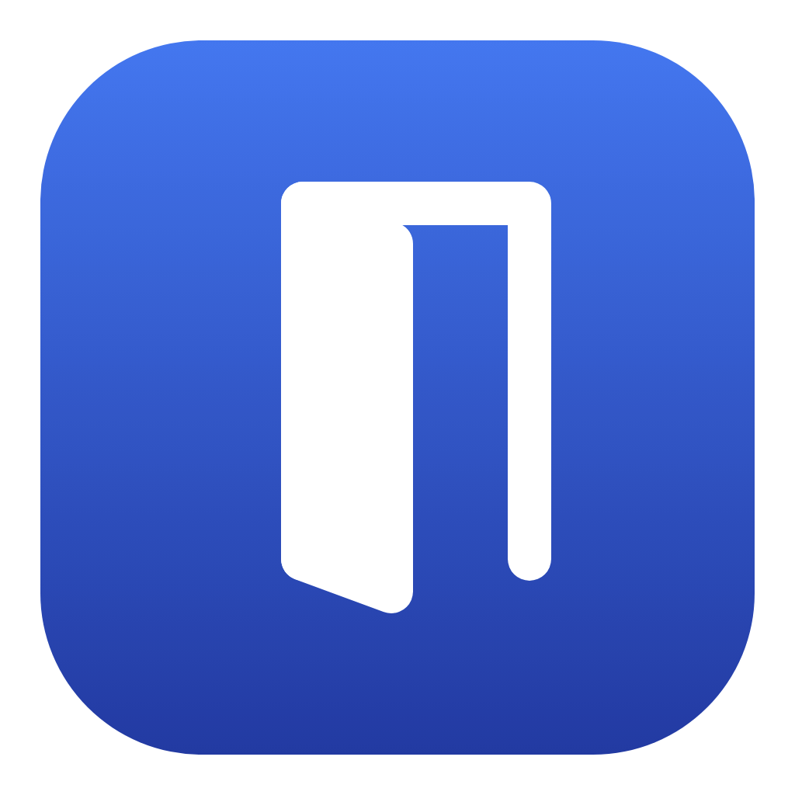

<p align="center">
  
</p>

# Doorman

A small native Swift + SwiftUI app: a picker for choosing which browser (or
browser profile) opens a link, with keyboard shortcuts, saved domains, private
windows, Recent, a doorbell, a login item and a favicon cache.

It reads and writes
`~/Library/Application Support/Doorman/handlers.json` and a `favicons/` folder,
under the bundle id `com.dakuupa.doorman`.

## Build

Needs Xcode (or its command line tools) with Swift 5.10+, on macOS 14 or later.

```bash
./build.sh            # builds build/Doorman.app
./build.sh --install  # ...and copies it to /Applications
./build.sh --release  # signed, notarized build/Doorman.dmg (maintainers)
```

Then open it once, go to **Settings → General → Register as default browser**,
and confirm when macOS asks.

### Release build

`./build.sh --release` signs the app with a Developer ID certificate and the
hardened runtime, notarizes it with Apple, staples the ticket and packages it as
`build/Doorman.dmg`. It needs the Developer ID Application certificate in your
keychain and a `.notarize.env` file in the project root (gitignored):

```
APPLE_ID=you@example.com
APPLE_TEAM_ID=XXXXXXXXXX
APPLE_APP_PASSWORD=xxxx-xxxx-xxxx-xxxx   # app-specific password from appleid.apple.com
```

The signing identity name is set at the top of the `--release` block in
`build.sh`; forks should change it to their own.

## Xcode

```bash
open Doorman.xcodeproj
```

The **Doorman** scheme builds and runs a real `Doorman.app`, with
`Resources/Info.plist` and the icon, so it can take links, register as the
default browser, offer its Services menu item and be a login item, the same as
the `build.sh` bundle. ⌘U runs the DoormanCore tests.

- The app target's sources are `Sources/Doorman` as a synchronized folder, so
  files added there join the target automatically. DoormanCore comes from this
  package as a local dependency, so there's one copy of each file.
- The test target compiles `Tests/DoormanCoreTests` the same way. Xcode doesn't
  offer a local package's own test targets to a project's scheme, so `swift
  test` and ⌘U run the same tests through two targets.
- Package schemes aren't auto-created (the project's shared workspace settings
  turn that off), so the bare `Doorman` executable doesn't show up as a second
  "Doorman" scheme.
- A run from Xcode uses your real settings folder. The scheme has a
  `DOORMAN_SUPPORT_DIR` variable and a sample URL argument ready under **Edit
  Scheme → Run → Arguments**, both unticked.
- It's signed to run locally (ad hoc), like `build.sh`. Xcode 16 or later is
  needed for the synchronized folders.

`build.sh` is independent of the project and unchanged; use either.

## Develop

```bash
swift build
swift test                                          # DoormanCore unit tests
.build/debug/Doorman https://example.com/some/path  # links passed on argv
```

A bare `swift run` / `.build/debug/Doorman` isn't an app bundle, so it can't
become the default browser or a login item. It always shows the picker on
launch.

Set `DOORMAN_SUPPORT_DIR` to point a run at a scratch settings folder instead
of your real one:

```bash
DOORMAN_SUPPORT_DIR=/tmp/doorman-test .build/debug/Doorman https://example.com
```

## Layout

| Path | What |
| --- | --- |
| `Sources/DoormanCore/` | No AppKit: `handlers.json` model and I/O, domain rules, browser/profile discovery, favicon HTML and byte sniffing. Covered by `Tests/`. |
| `Sources/Doorman/AppModel.swift` | The link queue, rules routing, launching, settings actions and keyboard handling. |
| `Sources/Doorman/AppDelegate.swift` | Launch, GetURL Apple events, main menu, and the key monitor that gives the picker its shortcuts. |
| `Sources/Doorman/PickerWindowController.swift` | The one window: placement near the cursor, height that follows the content, hide-not-close. |
| `Sources/Doorman/StatusItemController.swift` | Menu bar icon and its Recent menu. |
| `Sources/Doorman/Launcher.swift` | `posix_spawnp`, no shell, URL as its own argv entry, own session. |
| `Sources/Doorman/PageTitles.swift` | Fetching page titles for the picker, when turned on. |
| `Sources/Doorman/ServiceProvider.swift` | The "Open Links with Doorman" service. |
| `Sources/Doorman/SourceApps.swift` | Which app sent a link, and its name and icon. |
| `Sources/Doorman/HandlerIcons.swift` | App icons and Chromium profile photos for handlers. |
| `Sources/Doorman/Favicons.swift` | Fetching icons from each site into the cache folder. |
| `Sources/Doorman/Doorbell.swift` | The two-note chime, synthesized to PCM at first use. |
| `Sources/Doorman/Views/` | SwiftUI picker and settings. |
| `Resources/` | `Info.plist` (http/https URL types, the Services entry) and the app icon. |
| `Doorman.xcodeproj/` | The Xcode project: the app target, its test target and the shared scheme. |

## Notes

- Links arrive as GetURL Apple events. There's no single-instance lock, because
  LaunchServices already runs only one copy of an app bundle.
- A handler whose command can't be started shows the error under the list,
  rather than failing silently.
- The URL in the picker isn't selectable text, so `⌘C` always copies the whole
  link.
- The menu bar icon opens its menu on click, as native status items do;
  **Show Doorman** is the first item.
- **Page titles**, opt-in under **Settings → General → Show page titles in the
  picker**. The picker shows the page's title (its `<title>`, or `og:title`)
  between the host and the URL. It's off by default because it means loading
  each link's page before you choose. That's done without cookies, and a
  non-HTML response is left unread, but a one-time link (a sign-in, password
  reset or email verification link) can still be used up by it and then fail in
  your browser. Titles are held in memory for the session only. Saved as
  `"pageTitles"` in `handlers.json`.
- **The picker floats and never takes focus.** It's a non-activating panel,
  like Spotlight's. **Settings → General → Open the picker** sets where it
  appears:
  - **Centered on the front window** (the default): over the window of the app
    you clicked in, a third of the way down. The window's position comes from
    the system window list, which needs no extra permission. If there's no
    window, it centers on the screen.
  - **Centered on the screen**, a third of the way down.
  - **At the pointer**, with the pointer over its title strip so a stray second
    click can't choose a handler.

  Saved as `"pickerPlacement"` (`window`, `screen` or `pointer`) in
  `handlers.json`. It takes the keyboard while the app you clicked in stays
  active and keeps its menu bar, so after you choose you're straight back where
  you were. Click away and it stops floating and waits behind like a normal
  window. Settings is the exception: opening it activates Doorman, since its
  text fields need Doorman's Edit menu.
- **Open Links with Doorman** in the Services menu. Select text in any app,
  then right-click it or use the app menu → **Services → Open Links with
  Doorman**. Every web link in the selection goes through Doorman as if it had
  been clicked, up to 20 at a time: saved rules apply, and the rest queue in the
  picker. Bare domains count when macOS's link detection recognizes them
  (`github.com/fleetio`). The app you chose it in counts as the links' source
  for app rules. `./build.sh --install` refreshes the Services menu; a keyboard
  shortcut for it can be set in System Settings → Keyboard → Keyboard
  Shortcuts → Services.
- **Rules by source app.** Doorman knows which app a link came from, and the
  picker shows it ("from Slack") with a second checkbox, **Always open links
  from Slack with my choice**. Saved apps live under **Settings → Apps**, where
  **Add app…** creates one without waiting for a link and each row's menu
  changes its handler. A saved domain wins over a saved app. The sender is read
  from the link's Apple event and traced to the outermost `.app` it runs from,
  so helper processes count as their app. For a command-line sender, it's traced
  up through parent processes to the terminal. A sender that exits before
  Doorman looks, like a bare `open` command, shows no source. Stored as
  `"sourceRules"` (bundle id → handler id) in `handlers.json`.
- Handlers show the app they open instead of a plain color dot. A Chromium
  profile that's signed in shows its account photo, ringed in the handler's
  color, with a small browser badge. Otherwise the browser's icon carries a dot
  of the handler's color, so several profiles of one browser stay distinct.
  Photos are read from the browser's own profile folder, and changes show the
  next time the picker opens.
- The picker shows the link's site icon next to its host. A saved domain's
  comes from the cache folder. For any other site Doorman fetches it from the
  link's own origin, with no cookies, when the link arrives. It's held in memory
  for the session and never written to disk. A globe stands in until it loads,
  or when the site has none.
- **Settings → General → Appearance** picks System, Light or Dark. It's saved
  as `"appearance"` in `handlers.json`.
- `handlers.json` is written with sorted keys.

## License

[MIT](LICENSE) © 2026 Dakuupa LLC
